# ResonAI: Instant Pre-FEM Structural Dynamics & Vibration Triage

> **Interactive 3D vibration analysis, reduced-order modal dynamics, automated mount optimization, and AI copilot for beam and frame structures.**

---

## 1. Overview & Architecture

ResonAI bridges the gap between hand calculations and heavy 3D CAD/FEM software. It allows mechanical and aerospace engineers to rapidly screen structural designs for vibration risks, resonant crossings, and sensor limit violations in milliseconds rather than hours.

```mermaid
flowchart LR
    subgraph UI ["Frontend (Next.js 16 + React 19)"]
        Scene3D["3D Viewport (R3F / Three.js)"]
        Plots["Vibration Curves (Plotly.js)"]
        CopilotUI["AI Copilot Panel"]
        Store["Zustand State Store"]
    end

    subgraph API ["FastAPI Solver Gateway (127.0.0.1:8000)"]
        Router["Endpoints (/analyze, /optimize, /validate, /agent)"]
        Cache["LRU Cache & Concurrency Locks"]
    end

    subgraph Engine ["Scientific Computing Core (NumPy / SciPy)"]
        FEM["1D Timoshenko/Euler-Bernoulli Beam Discretization"]
        ROM["Krylov / Modal Projection (eigh)"]
        Opt["Differential Evolution Mount Tuning"]
        Agent["Gemini LLM + Offline Fallback Engine"]
    end

    UI <--> |REST / JSON Contract| API
    API <--> Engine
```



### Core Components
- **Frontend**: Next.js 16 (Turbopack), React 19, `@react-three/fiber` for 60 FPS deformed modal animations, `react-plotly.js` for FRF curves, Campbell diagrams, and spatial heatmaps.
- **Backend**: FastAPI with Python 3.11+, pure NumPy and SciPy eigensolvers (`scipy.linalg.eigh`), Differential Evolution optimizer, and Google Gemini API integration.
- **Frozen SI Contract**: Pure SI units internally (`m`, `kg`, `N`, `Pa`, `s`, `Hz`, `g = 9.80665 m/s²`).

---

## 2. Prerequisites & Quickstart

### Prerequisites
- **Node.js**: `v20.0+` (tested on `v22.18.0`) and `npm 10+`
- **Python**: `3.11+` (Python 3.13 recommended; `.venv` configured)
- **PowerShell**: Windows PowerShell 5.1 or PowerShell Core 7+

### One-Command Full Stack Launcher
Run both backend and frontend servers simultaneously:
```powershell
.\run_all.ps1
```
- **Frontend**: [http://127.0.0.1:3000](http://127.0.0.1:3000)
- **Backend API**: [http://127.0.0.1:8000](http://127.0.0.1:8000)
- **Swagger Docs**: [http://127.0.0.1:8000/docs](http://127.0.0.1:8000/docs)

Press `Ctrl+C` in the terminal to cleanly terminate both processes.

---

## 3. Individual Component Setup

### Backend Setup
```powershell
cd backend
python -m venv .venv
.\.venv\Scripts\Activate.ps1
python -m pip install --upgrade pip
pip install -r requirements.txt
cp .env.example .env
```

To launch only the backend:
```powershell
.\run_backend.ps1       # Production mode
.\run_backend_dev.ps1   # Hot-reload mode
```

### Frontend Setup
```powershell
cd frontend
npm install
cp .env.local.example .env.local
```

To launch only the frontend:
```powershell
.\run_frontend.ps1
```

---

## 4. Hero Demo Walkthrough (Quadcopter Diagonal Arm)

Follow these steps to experience the complete ResonAI vibration triage workflow:

1. **Load Hero Demo**:
   Navigate to [http://127.0.0.1:3000](http://127.0.0.1:3000). The **Quadcopter Diagonal Arm** (300 mm CFRP span, dual 12,000 RPM BLDC motors, center flight battery, IMU gyro, and 4K camera payload) is loaded into the 3D viewport.

2. **Simulate Shaking ("Test shaking")**:
   Click the **Test shaking** button in the top toolbar. In **~14 ms**, the ROM solver computes 400 frequency points across 1,000–12,000 RPM. Five diagnostic findings appear in the bottom panel:
   - **Mode 4 Resonance** (Arm bending at 4272 RPM)
   - **Mode 5 Resonance** (Torsional bending at 6023 RPM)
   - **Mount Amplification** on isolation pads
   - **Critical Camera Shake**: Camera reaches `1.44 g` peak acceleration, severely violating its `0.5 g` limit.
   - **IMU Shake Alert**: MEMS Gyroscope reaches `1.03 g` peak (limit `1.0 g`).

3. **Scrub Rotational Speed**:
   Drag the RPM speed slider in the top toolbar to **4272 RPM**. Notice how the 3D structure animates real-time resonant modal deformation (`/response_at`) with exaggerated displacement vectors.

4. **Auto-Fix Vibration ("Auto-fix")**:
   Click **Auto-fix** in the toolbar. The backend runs differential evolution over isolator stiffness ($k_v$) and damping ($\zeta$). Within ~6 seconds, candidate solutions are returned:
   - Camera isolation mount stiffness softened from $40\text{ kN/m}$ to optimal isolation range ($\sim 18\text{ kN/m}$).
   - Peak shaking drops by **over 60%** (from $1.44\text{ g}$ down to safe $<0.48\text{ g}$).

5. **Compare Before vs. After**:
   The viewport toggles into **Side-by-Side 3D Compare View**:
   - **Left**: Original vibrating airframe (red badge).
   - **Right**: Optimized candidate with softened pads (green badge).
   - Metrics cards display exact before/after accelerations, arm bending stress ratios, and weight deltas.

6. **Interactive AI Copilot**:
   Click the **Copilot** tab in the right dock:
   - Ask: *"Why is the camera shaking?"* — Copilot explains the frequency match with arm bending Mode 4.
   - Command: *"Make the arms carbon fiber"* — Copilot issues structured design ops (`set_material`), updates the airframe, and re-triggers analysis.

7. **Verify Physics Benchmark**:
   Click the **Shield Icon** in the toolbar to inspect live analytical benchmark status: all 22 textbook cases pass with `<0.056%` error.

---

## 5. Environment Configuration

### Backend (`backend/.env`)
| Variable | Default | Purpose |
| :--- | :--- | :--- |
| `HOST` | `127.0.0.1` | Binding network address |
| `PORT` | `8000` | Port for FastAPI server |
| `FRONTEND_ORIGIN` | `http://localhost:3000, http://127.0.0.1:3000` | Allowed CORS origins for browser client |
| `GEMINI_API_KEY` | *(empty)* | Optional Google Gemini key for LLM agent (falls back to local rules if unset) |
| `GEMINI_MODEL` | `gemini-2.5-flash` | Gemini model name |

### Frontend (`frontend/.env.local`)
| Variable | Default | Purpose |
| :--- | :--- | :--- |
| `NEXT_PUBLIC_API_URL` | `http://127.0.0.1:8000` | URL of the Python FastAPI solver backend |
| `NEXT_PUBLIC_USE_MOCK` | `false` | When `true`, bypasses backend and uses local in-browser solver |
| `NEXT_PUBLIC_RESONAI_MODE` | `backend` | Set to `demo` for standalone offline mode |

---

## 6. Physics Validation & Benchmark Credentials

ResonAI does not guess or invent vibration figures. All physics calculations are strictly verified against analytical textbook formulations:

- **22 Analytical Cases (Suite V1–V11)**:
  - Simply Supported Euler-Bernoulli Beams (Modes 1, 2, 3)
  - Fixed-Free Cantilever Beams (Modes 1, 2, 3)
  - Fixed-Fixed Beams
  - Beam with Tip Mass & Inertia (Blevins Table 8-1)
  - Elastic Spring Supports & Compliance
  - L-Frame & Portal Frame Structural Dynamics
  - Timoshenko Shear Correction Verification
  - Half-Power Bandwidth Damping Verification
- **Analytical Accuracy**: Maximum discrepancy across all 22 cases is **$<0.056\%$** against closed-form equations.
- **Solver Speedups (on identical 125-DOF FE model)**:
  - **22.5x to 92.2x faster** than direct dense complex solves ($K + i\omega C - \omega^2 M$).
  - **0.7x to 9.1x faster** than sparse direct solves (`scipy.sparse.linalg.splu`).

---

## 7. Automated Test Suite & Quality Gates

Run the comprehensive check across both frontend and backend:
```powershell
.\check_all.ps1
```

Individual test runners:
```powershell
# Fast backend test suite (< 25 s)
cd backend
pytest -m "not slow" --durations=8

# Full backend test suite including optimizer
pytest --durations=8

# Frontend static type check & ESLint
cd frontend
npm run lint
npx tsc --noEmit

# Frozen JSON contract verification
npm run check:contract

# Next.js production build verification
npm run build
```

---

## 8. Frozen API Contract Endpoints

| Endpoint | Method | Input | Output / Description |
| :--- | :--- | :--- | :--- |
| `/health` | `GET` | — | Service health and version status |
| `/presets` | `GET` | — | Materials, mounts, components, and structure catalogue |
| `/presets/{name}/design` | `GET` | Name | Complete design specification for structural templates |
| `/analyze` | `POST` | `Design` | Full frequency sweep, Campbell lines, screening findings, max stress |
| `/analyze/mock` | `POST` | `Design` | Frozen mock response matching `mock_analyze.json` |
| `/response_at` | `POST` | `Design, rpm` | Complex modal deflection vectors at specific RPM for 60 FPS animation |
| `/optimize` | `POST` | `Design, locks, budget` | Differential Evolution mount tuning with candidate before/after metrics |
| `/validate` | `GET` | — | 22 live analytical validation cases, mesh convergence, and speedup benchmarks |
| `/agent/chat` | `POST` | `AgentRequest` | LLM structural dynamics copilot with validated closed-vocabulary ops |
| `/agent/health` | `GET` | — | LLM provider connectivity status (no secrets exposed) |

---

## 9. License

Proprietary — ResonAI Engineering Dynamics Team.


